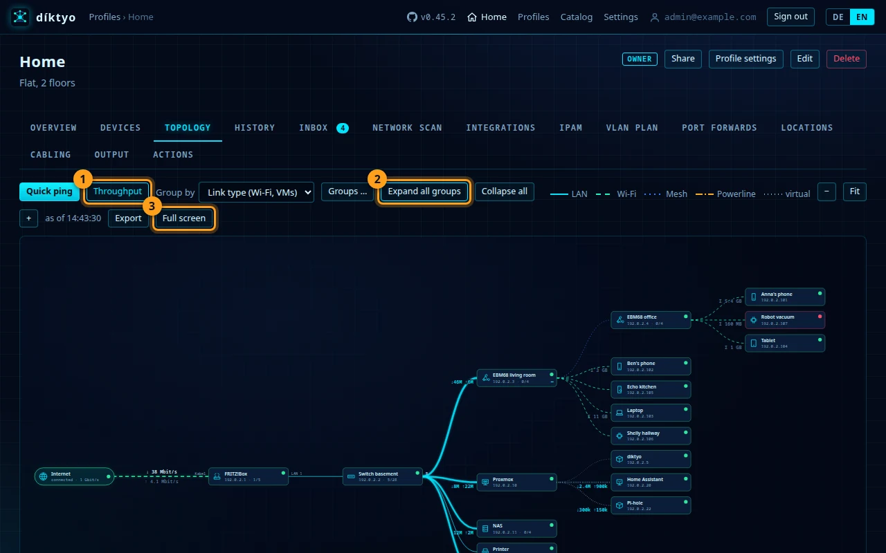

# díktyo – network documentation for home networks

díktyo (Greek δίκτυο, "network") documents a home network: devices with IP, MAC, location and notes, IP address
management with subnets and VLANs, and a graphical topology that shows how everything is connected. It is meant
to be a slim, self-hosted alternative to NetBox for private users. It runs as a single service with an SQLite
file, either in a Proxmox LXC or in a Docker container, and is managed in the browser. The interface is available
in German and English.

> **New here? Start with the illustrated [Getting started](docs/GETTING-STARTED.md) guide** (German:
> [Erste Schritte](docs/ERSTE-SCHRITTE.de.md)) – install, scan, connect your router, done in about 15 minutes.

[](docs/GETTING-STARTED.md)

> **Status: v0.37 – MVP (M0–M6) complete, phase 2 in progress.** German step-by-step guide:
> [docs/ANLEITUNG.de.md](docs/ANLEITUNG.de.md). Plan, add-ons and improvements: [docs/ROADMAP.de.md](docs/ROADMAP.de.md).

## Installation

Both ways serve the web interface on port **8090**. The first account created in the browser becomes
administrator.

### Option 1: Proxmox LXC (recommended)

Run this on the Proxmox host as root:

```bash
bash -c "$(curl -fsSL https://raw.githubusercontent.com/xpistaki-bit/diktyo/main/install/install-proxmox.sh)"
```

The script creates an unprivileged Debian container (13, otherwise 12), installs the app and prints the address.

Defaults: next free container ID, storage picked automatically (`local-lvm` or `local-zfs` if present), bridge
`vmbr0`, DHCP, 8 GB disk, 1024 MB RAM, 2 cores. Override them with variables:

```bash
CTID=130 IP=192.168.178.50/24 GW=192.168.178.1 VLANS="10:192.168.10.5/24,20:dhcp" \
  bash -c "$(curl -fsSL https://raw.githubusercontent.com/xpistaki-bit/diktyo/main/install/install-proxmox.sh)"
```

| Variable | Meaning | Default |
|---|---|---|
| `CTID` | container ID | next free ID |
| `NAME` | hostname | `diktyo` |
| `STORAGE` | storage for the container disk | automatic |
| `TPL_STORAGE` | storage for the Debian template | automatic |
| `BRIDGE` | network bridge | `vmbr0` |
| `IP`, `GW` | static address (CIDR) and gateway of `eth0` | DHCP |
| `VLANS` | extra interfaces, one per VLAN: `TAG:IP/CIDR` or `TAG:dhcp`, comma-separated | none |
| `DISK`, `RAM`, `CORES` | disk in GB, memory in MB, CPU cores | 8, 1024, 2 |
| `DIKTYO_PORT` | port of the web interface | 8090 |
| `DIKTYO_IPV6=1` | let apt use IPv6 (IPv4 is forced by default) | off |

**One interface per VLAN.** díktyo scans each network from inside it, so it sees MAC addresses and broadcast
services there. Every entry in `VLANS` adds `ethN` with that VLAN tag on the same bridge and **no gateway**, so
traffic to other networks keeps leaving through `eth0`. Requirements: the bridge is VLAN-aware
(`bridge-vlan-aware yes`) on **every** cluster node the container may run on, and the switch ports of the Proxmox
nodes carry the VLANs as tagged (trunk).

**Update** (data is kept; `VLANS=...` adds missing VLAN interfaces):

```bash
CTID=130 bash -c "$(curl -fsSL https://raw.githubusercontent.com/xpistaki-bit/diktyo/main/install/update-proxmox.sh)"
```

On any other Debian or Ubuntu machine (VM, bare metal), run `bash install/setup.sh` as root.

| What | Where |
|---|---|
| Program | `/opt/diktyo` |
| Data (database, key) | `/var/lib/diktyo` |
| Services | web app `diktyo`, background service (network scan) `diktyo-worker`: `systemctl status diktyo diktyo-worker` |
| Logs | `journalctl -u diktyo -u diktyo-worker` |
| Command line | `diktyo --help` (inside the container) |
| Shell in the container | on the host: `pct enter <CTID>` |

### Option 2: Docker

Requirements: Docker Engine with the Compose plugin, on a Linux host in the network to be documented.

```bash
git clone https://github.com/xpistaki-bit/diktyo.git
cd diktyo
docker compose up -d --build
```

The container uses the **host network** so that the network scan sees the LAN directly; the port is set with
`DIKTYO_PORT` in `docker-compose.yml`. All data lives in the named volume `diktyo-data`. Web app and background
service (network scan) run in the same container; nmap's operating-system detection is not available in Docker.

| Task | Command |
|---|---|
| Update | `git pull && docker compose up -d --build` |
| Logs | `docker compose logs -f` |
| Command line | `docker compose exec diktyo python -m app.cli --help` |

Do not install Docker directly on a Proxmox host; use the LXC instead, or a VM.

## Accounts and profiles

- **Sign-in** with e-mail address and password. The first account becomes administrator; further accounts are
  created by an administrator (Settings → Accounts), or by the people themselves if self-registration is allowed.
- **Profiles** are networks or sites, for example home, parents or holiday house. The owner can share a profile
  with other accounts as *View*, *Edit* or *Owner*. Administrators can open every profile.
- **Forgot password:** with SMTP configured (Settings → Sending e-mail) a reset link is sent. Without it, an
  administrator generates a new password in the account list, or on the server:

  ```bash
  diktyo reset-password me@example.com                                    # LXC
  docker compose exec diktyo python -m app.cli reset-password me@example.com   # Docker
  ```

## Devices and network

Each profile has the tabs **Devices**, **IPAM**, **Locations**, **Output** and **Sharing**.

- **Devices:** name, type, catalog model, manufacturer/model, location, hostname, MAC, one or more IP addresses
  (static, DHCP, reserved), notes and tags. The table can be searched, filtered by type and location, and sorted
  by any column.
- **Ports:** a catalog model creates the ports of a device (for example 24 × RJ45 + 4 × SFP+ for a Zyxel
  XGS1935-28). The port groups can be changed per device: count, kind, speed, label, PoE.
- **Connection:** every device has one uplink: *LAN* (optionally to a specific port of a switch or router, and
  from a specific own port), *Wi-Fi* or *mesh backhaul* to an access point or mesh node, or *virtual* for a VM or
  container running on a host. An occupied port cannot be used twice, and loops are rejected. The device dialog
  shows the port assignment and all devices connected to it.
- **IPAM:** subnets with gateway, DNS, DHCP range and VLAN; usage per subnet; assigned and free addresses (free for
  static use vs. inside the DHCP pool). Notes point out duplicate IPs or MACs, static IPs inside the DHCP range,
  addresses outside every subnet and overlapping subnets.
- **Locations:** a tree such as house › ground floor › office. Each location opens a **floor plan**: upload a picture
  (PNG, JPEG, WebP, GIF) or use a grid, then drag devices, patch panels/outlets and sub-locations (as rectangles)
  onto it; dots show the online status and a click opens the device or room. A location of kind **rack** (with its
  number of rack units) shows a front view: mount devices, patch panels and other items (UPS, blank panel, shelf)
  by dragging, with port usage per device. Both appear in the PDF section *Floor plans and racks* and in the backup.

## Topology

The tab **Topology** draws the network as a tree from left to right, built from the connections of the devices:
router → switch (with the port names on the lines) → access points, servers and so on. Line styles show the
medium: solid LAN, dashed Wi-Fi, dotted mesh backhaul, fine virtual (VMs and containers on their host). Devices
without a connection are listed separately.

- Wi-Fi clients of an access point or mesh node (from 4) and VMs of a host (from 5) are combined into one box, for
  example "12 Wi-Fi devices · 9 online"; a click expands it.
- **Groups:** "Group by" switches between link type (as above), **custom groups** ("IoT", "Cameras", "Kids' room",
  each with a colour and its members), **location**, **tag** and **VLAN** (from the switch port, the Proxmox tag or the
  subnet). Each group becomes its own box below its access point or switch; devices without a group fall back to the
  Wi-Fi/VM boxes. "Groups …" manages the custom groups and the thresholds (0 = never combine). Group boxes can be
  moved and appear in the PDF and the network plan export.
- Drag to move, mouse wheel or −/+ to zoom, "Fit" to see everything. A click on a device shows its details at the
  side, a double click opens the detail view.
- **Detail view** of a switch or router: the front panel with all ports (odd numbers on top, even at the bottom,
  SFP ports set apart) and the connected devices around it; the uplink is marked. A click on a port shows the
  device behind it with name, IP and MAC, and with SNMP also link speed, traffic, learned MAC addresses and the
  LLDP neighbour. Wi-Fi, mesh and virtual devices are listed at the side and can be collapsed.
- **Quick ping** checks all devices (or those of the detail view) at once; the online status is refreshed every
  30 seconds while the view is open.
- The PDF can contain the topology as a graphic (section "Topology graphic").

- **Move devices** with the mouse; positions are stored per profile (also used for the PDF), "Reset layout" restores
  the automatic arrangement.
- **Full screen** enlarges the topology to the whole window below the header; Esc returns to normal size.
- **Internet:** a globe in front of the WAN router. With the FRITZ!Box (or UniFi) integration it shows whether the
  internet connection is up (animated green line or red) and the current traffic down/up on the line.

## Overview

Each profile opens with an **overview** in HUD style that uses the full screen width: large key figures (devices
online as a segment bar, internet with download/upload against the line rate, infrastructure availability as a ring,
firmware updates, inbox, changes since yesterday); WAN traffic as a bar chart (download up, upload down); the last
speed test as two gauges with ping and jitter plus its history; a "needs attention" list; the busiest switch ports with
the **device behind each port**; devices moving data right now; response times per infrastructure device (24-hour
average, maximum and sparkline); infrastructure cards with availability ring; Pi-hole/AdGuard and recent changes. Chart
labels are HTML, so they stay readable at every width. It refreshes every 30 seconds without flicker.

The overview is **customizable** per profile (editors and owners): drag panels or move them with ◀ ▶, choose their
width, hide or show them, and **pin your own charts** – the WAN of an integration, a specific switch port (with the
device behind it), ASUS interfaces, DNS queries, or the response time or power of a specific device, as bars or a line
with your own title. Integration cards and the device dialog have a pin button to pin a chart directly.

A **watchlist** keeps an eye on important systems (e.g. a Proxmox quorum node): mark them with "Watch" in the device
dialog, and the watchlist panel on the overview turns red while one is offline and yellow when it went down or changed
its IP, MAC, name or connection – showing old → new – until someone acknowledges it. Changes made in díktyo itself
don't count. Optionally each alarm is also sent by e-mail/ntfy. On the
integrations page, cards with charts or port lists take two columns, simple ones one.

In the topology, **Throughput** shows the current traffic on every connection, with line width following the load:

| Connection | Source |
|---|---|
| wired | switch (SNMP), MikroTik and OPNsense ports, UniFi/Omada switch ports |
| per device (also Wi-Fi) | live rate from Omada, UniFi, MikroTik (Wi-Fi registrations, Kid Control), OPNsense (top talkers) |
| VMs and containers | Proxmox (network counters per guest) |
| Wi-Fi with ASUS | data volume of the last 24 hours (Σ) from the Traffic Analyzer – ASUS has no live rate per client |

Collapsed groups show the sum of their members; the device dialog shows the current rate as well. FRITZ!Box and
Docker do not expose traffic per device.

## Reachability and firmware

Online monitoring also records the response time of every ping. The device dialog shows availability over 24 hours,
7 and 30 days (outages, longest outage), the average response time and a chart. Firmware hints come from the
integrations: FRITZ!Box, ASUS, MikroTik (RouterOS and RouterBOOT), UniFi and Omada per device, Proxmox as pending
package updates. Devices with an update are marked in the topology, version changes appear in the history, and new
updates can be reported to Home Assistant. An overview lists problems first.

## Sign-in with OIDC (Authentik, Keycloak, Logto …)

Administrators can connect an OpenID Connect identity provider under Settings → Sign-in with OIDC (SSO); the sign-in
page then shows "Sign in with …" next to the password form. díktyo uses the authorization code flow with PKCE, state
(bound to the browser) and nonce, and verifies the ID token signature via the provider's JWKS (RS*, PS*, ES* – Logto
uses ES384 – and HS* with the client secret) plus issuer, audience and expiry. Existing accounts are linked by e-mail
only if the provider reports the address as verified (or the admin explicitly trusts it); users can also link their
account in their own settings. Optional: create accounts automatically, allow only members of a group, grant admin
via a group. The provider handles the second factor for these sign-ins.

## Prometheus and Grafana

Integrations → Prometheus / Grafana exposes the profile's metrics at `/api/profiles/<id>/prometheus` in the Prometheus
text format, protected by a per-profile bearer token (shown once, stored hashed, owner only). The panel shows a ready
`scrape_configs` entry and offers a ready-made **Grafana dashboard** to import. Metrics (prefix `diktyo_`) include
devices online/offline and per device up, response time, 24 h availability, power, firmware updates, WAN traffic,
traffic per switch port (with the connected device) and interface, DNS queries/blocked, last speed test, integration
health, watchlist alarms, open VLAN plan changes and the inbox. díktyo serves the current state; Prometheus keeps the
history.

## Notifications

Integrations → Notifications sends the events of a profile by **e-mail** (via the SMTP settings) and/or **ntfy**
(push to the phone; ntfy.sh or your own server, optional access token) – independently of Home Assistant. Choose the
events: device offline/online (optionally infrastructure only), new device, quarantine, firmware update, failed undo
or schedule, internet slow (speed test below half the line rate), configuration backup failed, integration failing
(for 15 minutes), watchlist alarm. Events are bundled into one message at most once a minute; enabling starts from now, without old
events. "Send test message" checks each channel. The ntfy token is stored encrypted.

## Speed tests

- **Internet:** "Measure now" in the overview (or Integrations → Speedtest) measures ping, jitter, download and upload
  of the díktyo host against `speed.cloudflare.com` – parallel connections for a few seconds per direction, at most
  600 MB down and 150 MB up per run. Optionally automatic every 3, 6, 12 or 24 hours. The history is kept for two
  years, shown as a chart, and the overview warns when the download falls below half of the line rate reported by the
  router (FRITZ!Box). The result covers díktyo's path to the internet, including any router in between.
- **iperf3 to a device:** in the device dialog, "Measure throughput (iperf3)" measures both directions between díktyo
  and a device running an iperf3 server (`iperf3 -s`, port 5201), with history per device. The installer includes the
  iperf3 client (it is not started as a server).

## History

The **History** tab shows what changed when and why: devices added or removed, name, type, status, model, location, IP
addresses, MAC and connection (e.g. switch port 3 → 5), each with its source (by hand with the account, network scan,
FRITZ!Box, SNMP, MikroTik, service scan …), plus online/offline, actions, new configuration versions, quarantine and
open ports appearing or disappearing. A "since yesterday" summary, filters, search and CSV export; the device dialog
shows the last 30 days. Roaming between Wi-Fi/mesh access points is not recorded. Kept for a year and included in backups.

## Network scan and identification

The tab **Network scan** finds the devices in the network; new ones land in the **Inbox** with a guess of what
they are, for example "Amazon Echo (Alexa) · 78 %" with the reasons (manufacturer of the MAC address, open ports,
mDNS services, UPnP model, title of the web interface, DNS name). Accept them into the device list (directly or
after editing), or ignore them; ignored devices are recognised in later scans and not reported again. Known devices
are matched by MAC address (otherwise by IP); the scan only fills in empty fields and never overwrites manual
entries. A changed DHCP address is updated, static addresses stay untouched.

| Mode | What happens |
|---|---|
| Passive | reads the ARP table, asks mDNS/Bonjour and UPnP, resolves DNS names; no pings, no port probes |
| Light | adds ping and about 20 common TCP ports per address, reads the title of web interfaces |
| Full (default) | adds about 60 ports, NetBIOS names and service detection with nmap; takes a few minutes for a /24 |

- **Networks:** without a selection, the IPv4 subnets from IPAM are scanned, otherwise the networks of the
  container's own interfaces (one per VLAN, see installation). Networks that are not in IPAM yet are created, so a
  first scan can initialise an empty profile. At most /20 per network.
- **Exclusions:** addresses or networks that are never probed actively, for example sensitive older cameras.
- **Schedule:** manually, hourly, every 6/12 hours, daily or weekly. Every scan updates online/offline and the
  status history of the devices (shown in the device dialog).
- **Identification rules** live in the catalog (tab "Detection rules") as data: conditions on manufacturer,
  hostname, mDNS, UPnP, web interface, open ports and random MAC addresses, each with a weight. Administrators can
  add and edit rules or import/export them as CSV. A catalog model is suggested when the model name appears in the
  UPnP data or the web interface (for example "ExpertWiFi_EBM68" → ASUS ExpertWiFi EBM68 with its ports).
- **Manufacturer list:** the IEEE OUI lists are downloaded at runtime (not shipped in the repository) and renewed
  every 30 days; Settings → Detection shows the state.
- **Fingerbank** (optional, external): with a free API key (Settings → Detection) and switched on per profile,
  MAC address and hostname of unknown devices are sent to fingerbank.org for a better guess.
- **Networks behind a router:** a scan sees MAC addresses, mDNS and UPnP only in the networks the container is
  directly connected to. Other networks (for example the FRITZ!Box network when díktyo runs behind an ASUS router in
  router mode) are reached by ping/TCP, without MAC addresses; the FRITZ!Box integration fills this gap.
- **Privileges:** discovery needs no root rights (ping and TCP connections fill the kernel's ARP table). Only the
  operating-system detection of nmap needs `CAP_NET_RAW`; in the LXC the background service gets it, in Docker it
  stays off.

## Integrations and monitoring

The tab **Integrations** connects devices that díktyo queries directly (read-only), every 30 s to 15 min:

- **FRITZ!Box (TR-064).** Without a password díktyo reads the host list (MAC, IP, name, LAN/Wi-Fi, active) and the
  WAN traffic. This also covers devices in networks behind another router, which a scan only sees without MAC
  addresses. With a FRITZ!Box user the mesh topology is added (which device is on which LAN port or Wi-Fi, which
  sets the connections automatically) plus Wi-Fi networks. Create the user under System → FRITZ!Box Users with the
  permission "FRITZ!Box settings"; "Allow access for applications" must be on (Home Network → Network → Network
  Settings). New devices land in the inbox; known ones are updated and shown online/offline.
- **Switch (SNMP v2c or v3** with SHA/SHA-256/MD5 authentication and AES-128 encryption), for example the Zyxel XGS1935: port status and speed, traffic per port (from the 64-bit
  counters), MAC addresses learned per port and LLDP neighbours. Devices whose MAC address appears alone on a port
  are connected to that port automatically; on a port with many addresses the switch, access point or router behind
  it is chosen. Enable SNMP on the switch (Zyxel: Management → Access Control → SNMP) and set a community.
- **ASUS router with AiMesh** (for example ExpertWiFi EBM68): clients with name, IP, MAC, Wi-Fi band and the mesh
  node they are connected to, plus the mesh nodes with their backhaul (mesh or LAN). Sign in with the router's admin
  account (web interface, usually HTTPS port 8443). ASUS allows only one admin session at a time; díktyo keeps its
  session open, and the default interval is 5 minutes. The Traffic Monitor (WAN, LAN and each Wi-Fi band, with WAN
  history) and, when enabled on the router, the Traffic Analyzer (data volume per client over the last 24 hours) are
  shown on the card, the overview, the device dialog and the topology. ASUS exposes no live rate per Wi-Fi client.
  "Diagnose" on the card checks step by step what the firmware returns.
- **Proxmox VE** (API token, read-only): nodes, VMs and containers with status, MAC, bridge, VLAN tag and IP
  addresses (via the QEMU guest agent for VMs and the interface list for containers); they are attached to their host
  as "virtual". The token setup is shown in the dialog and in [docs/architecture.md](docs/architecture.md).
- **Home Assistant:** names and areas of HA devices are taken over by MAC address; via MQTT díktyo reports online
  sensors, counters, WAN traffic and events (device offline/online, new device). A blueprint for phone notifications
  is in [docs/home-assistant](docs/home-assistant/README.md).
- **TP-Link Omada** (Open API of the software controller, OC200/OC300 or gateway with controller; app in "Client"
  mode with Client ID, Client Secret and Omada ID): gateways, switches and access points with their uplink device and
  port, and the clients with the access point or switch port they are connected to.
- **Ubiquiti UniFi** (local Network Integration API with an API key, UniFi Network 9.0 or newer; consoles and
  self-hosted controllers): gateway, switches and access points with port status (shown on the front panel), the
  connected clients with their access point or switch, and the gateway's WAN traffic.
- **MikroTik RouterOS 6 and 7** – by default over the **RouterOS API** (service api, port 8728, or api-ssl 8729 with
  TLS; user with read + api), alternatively **SNMP v2c/v3** (read only, no actions, no DHCP names) or REST
  (RouterOS 7, www-ssl/www): ports with link, speed, traffic and PoE,
  clients from DHCP/ARP with the port or Wi-Fi they use (bridge hosts, registration table), MNDP/LLDP neighbours and
  WAN traffic; actions port off/on, PoE restart, Wi-Fi on/off, Wake-on-LAN, restart (write/reboot/test). No
  configuration backup – RouterOS has its own backups (also to the MikroTik cloud).
- **OPNsense** (official REST API with key/secret): interfaces with status and traffic, clients from DHCP leases and
  ARP, WAN status/traffic, firmware updates, `config.xml` backup; internet block per device via a firewall alias.
- **Docker** (Engine API, ideally through a socket proxy): containers as virtual devices on the Docker host with image,
  state, networks and published ports; start/stop/restart as actions.
- Omada, UniFi, MikroTik, OPNsense and Docker were built from the vendors' API documentation and tested against simulated controllers, not yet
  against real hardware – feedback welcome.
- Connections set by an integration never replace connections entered by hand.
- **Online monitoring:** all confirmed devices with an IP address are pinged every 30 s, 1 min or 5 min (per
  profile); devices that drop pings are checked through a known open port. The device dialog shows the last
  changes.
- **Measurements** (WAN traffic, port traffic) are kept 2 days by default, up to 14 (Settings → Detection), and
  shown as charts over 2 h, 24 h, 2 days or 7 days.

- **Service scan (nmap) on demand** in the device dialog: open TCP ports with service, product and version, web page
  titles and TLS certificates with expiry date (quick 100 / standard 1000 / all ports).
- **SNMP diagnosis** in the switch dialog: network path (including the NAT address the switch sees when díktyo is in
  another network), reachability, whether the SNMP service answers at all, and the sign-in.
- **FRITZ!Box second factor:** if FRITZ!OS asks for a confirmation for the configuration export, díktyo shows how to
  confirm (button on the box, phone code, or the code from an authenticator app via the web interface) and continues;
  scheduled backups show a note instead.

Integrations and monitoring run in the background service next to the scans. Credentials are stored encrypted and
go into backups only with the backup passphrase.

## Actions

Profile owners can switch things through the integrations (device dialog, topology side panel, front panel port):
Wi-Fi on/off and restart (FRITZ!Box), block/allow internet access and Wake-on-LAN for devices in the FRITZ!Box
network, switch port off/on and PoE restart (SNMP with write access), start/shut down/restart VMs and containers
(Proxmox token with `VM.PowerMgmt`), restart managed devices and PoE restart on switch ports via UniFi and Omada
(Omada also PoE on/off), Shelly/Tasmota outputs on/off and firmware update. Every action shows a preview and asks for confirmation; Wi-Fi, internet block and
switch ports can switch back automatically (15 min, 1 h, 2 h, tomorrow 6:00). The configuration is backed up first if
the last backup is older than an hour. **Schedules** run actions on weekdays and times (with a time window for
reversible actions, e.g. internet blocked Mon–Fri 22:00–06:30, switching only at the transitions). **Quarantine** blocks
internet access (FRITZ!Box) for every new device until it is accepted in the inbox. díktyo refuses to disable the switch port it or the router uses to reach the
switch, does not block infrastructure from the internet and does not shut down its own VM. All actions are logged.

## Pi-hole / AdGuard Home

The integration "Pi-hole / AdGuard Home" reads host names (rDNS, DHCP) and fills in empty host names of devices
(placeholder names in the inbox are replaced; names you set stay), shows queries and blocked queries per device (device
dialog, card) and in total, the most blocked domains, and queries/blocked per minute as a chart on the overview. Pi-hole
v6 uses an app password and keeps one session (Pi-hole limits sessions); Pi-hole v5 works with the API token (summary and
top clients only); AdGuard Home uses the web login (blocked per client from the recent query log). Action: turn the ad
blocker/protection off and on, with automatic switch-back. Only numbers per device are stored, no visited domains.

## Shelly / Tasmota

The integration "Shelly / Tasmota" talks to the devices directly (no cloud). With the address "auto" it polls every
device the network scan recognised as Shelly or Tasmota (plus Espressif ESP modules); further IPs can be added. Shelly
Gen1, Gen2/3/4 (RPC, digest auth) and Tasmota are detected automatically. díktyo shows outputs, power, energy, Wi-Fi
signal and firmware (with update hint) per device, keeps the power history as a chart in the device dialog, and offers
switching outputs (with automatic switch-back) and firmware updates as actions.

## Device configuration backups

Integrations that can read a device's configuration back it up weekly or daily (setting in the integration) or on
demand ("Back up configuration"): the FRITZ!Box export (needs the FRITZ!Box user), the settings file of ASUS routers,
and the running configuration of switches via SSH (`show running-config`; sign-in with user and password, with
díktyo's own key – its public key is shown in the dialog to upload to the switch – or with your own private key). Unchanged configurations are not stored twice; the last 30 versions per device are kept, encrypted on
disk. The device dialog lists them for download and shows the changes between two text configurations. With a backup
passphrase, the newest configuration of each device is included in díktyo backups (encrypted with the passphrase).

## Catalog

The starter catalog contains about 80 devices from AVM (FRITZ!Box, Repeater, Powerline), Zyxel, ASUS (ExpertWiFi,
ZenWiFi, RT), TP-Link Omada, Netgear, devolo, Ubiquiti UniFi, Synology and generic switches/routers. Port counts
follow the manufacturers' product descriptions but are **not individually verified** against data sheets; an
administrator can mark an entry as verified. The starter catalog is generated by `tools/seed.py`.

Administrators can add their own entries, edit existing ones (they then count as custom and are no longer changed
by updates) and import a CSV (separator `;` or `,`, German or English column names). Ports are written as
`count:kind:speed:label:poe`, groups separated by commas, for example `24:rj45:1G, 4:sfp+:10G` or
`1:rj45:2.5G:WAN, 3:rj45:1G:LAN`. "CSV template" downloads an example.

The catalog may list every connector of a model (USB, HDMI, Thunderbolt, MagSafe, card reader …), but devices only
get **network ports** (RJ45, SFP, fiber, DSL, coax), numbered consecutively – so the device dialog, topology, VLAN plan,
cabling and PDF show only what matters for the network.

### Catalog entry from system info

"From system info" takes pasted output of `dmidecode -t system`, `lspci`, `hostnamectl` or PowerShell
(`Get-CimInstance Win32_ComputerSystem`), detects manufacturer, model, type and network ports (speed from the NIC
model), optionally looks up a short description on Wikipedia (only manufacturer and model are sent) and opens the
prefilled catalog dialog for review. Serial number and UUID are never stored in the catalog or sent anywhere.

**AI research (optional):** with a Claude API key (Settings → AI research) díktyo researches data sheets via the
Claude API with web search and fills in type, ports, Wi-Fi and key data ("Complete with AI" in the catalog dialog, or
directly from system info). The suggestion shows its sources, a confidence rating and the approximate cost; only
manufacturer, model and detected key data are sent. Default model Claude Opus 5.5, selectable.

## VLAN plan

The **VLAN plan** tab shows which port is in which VLAN: each switch/router as a row of port tiles (untagged VLAN as
colour and number, tagged VLANs as stripes, connected device below) or as a port × VLAN matrix. **Productive** is the
current state – read from switches with an SNMP integration (Q-BRIDGE-MIB, read-only), otherwise entered by hand.
**Plan** is a separate copy for a migration: add planned VLANs, select ports (shift-click for ranges) and assign
untagged/tagged VLANs. díktyo lists every port to change (productive → plan), warns when a device's static address
doesn't fit the new VLAN's subnet or an uplink doesn't carry a VLAN used on the other switch, and ticks ports off
automatically once an SNMP switch reports the new state. VMs and containers from the Proxmox integration appear under
their host with the VLAN tag of their network card, and the plan checks that the switch port to the host carries
those VLANs tagged. díktyo never writes to the switches.

## Cabling (cables and patch panels)

The **Cabling** tab documents which switch port leads through which patch panel and wall outlet to which device,
with the numbers on the cables: switch port → patch cable → patch panel port → installed cable → outlet → device
cable → device (each part optional). Patch panels and outlets are shown as port grids; click a free port to add a
cable run. Each run is checked against the connection detected on the switch port (✓ matches, ⚠ something else is
connected there). Cable runs also appear in the device dialog, in the PDF ("Cabling" section) and in backups.

## Updates

Settings → Updates (administrators) shows the installed and the latest version on GitHub with its changes; the header
shows "↑ Update" when a new version is available (checked at most every 12 hours). On installations made with the
Proxmox script / `setup.sh`, **Update now** places a request file; a systemd path unit (`diktyo-update.path`) then runs
a fixed root script that backs up the database, downloads the branch from GitHub and runs `setup.sh`, while the page
shows progress and reloads into the new version. The web app never runs anything as root; the source repository and
branch live in `/opt/diktyo/update.conf`. Existing installations get the update service with their next update via
`update-proxmox.sh`. Docker: rebuild with `git pull && docker compose up -d --build`.

## Languages

The interface is available in German and English. With English selected, messages from the server (errors, results
of actions, diagnostics, stored errors of integrations) are shown in English as well, and so are notifications if their
language is set to English. A test checks that every message in the code has an English version.

## Output

**Network map:** Output → Network map (or Topology → Export) exports the topology – laid out as in the interface,
including devices moved by hand – as a **poster PDF** (A4 to A0 with a title block and legend, optionally tiled onto
A4 sheets with overlap and sheet numbers for printing at home), **SVG**, **PNG** or a **draw.io** file in which every
device carries IP, MAC, type, model and location as properties. Groups (Wi-Fi devices, VMs) can be expanded.


**Output** creates a PDF in a light print layout. Choose the sections: topology graphic, device list, IP plan per subnet, VLAN
overview, port assignment per switch, Wi-Fi overview (clients per access point/mesh node) and notes. The device
list and the IP addresses are also available as CSV.

**QR labels** for your devices: stickers whose QR code opens the device dialog in díktyo on a phone (after signing in
if needed), with name and optionally IP, MAC, location and type next to it. Formats: A4 sheets 70 × 37 mm (24),
99.1 × 38.1 mm (14), 48.5 × 25.4 mm (40) and label printers 62 × 29 mm (Brother DK-11209) and 54 × 25 mm (Dymo 11352).
Choose devices, a start position for partly used sheets and optional cut lines; the address in the QR code defaults
to the "web interface address" from the e-mail settings. The device dialog has a "QR label" button for a single device.

**Cable labels** from the cable numbers in *Cabling*: the number in large type with both ends of the cable below it
(or one label per end that names the far end), a colour bar for the kind (patch, installation, device cable).
Formats: A4 sheets 38 × 21.2 mm (65, Avery 3666/L7651), 48.5 × 25.4 mm and 70 × 37 mm, label printers 62 × 29 mm and
54 × 25 mm, and 12 mm label tape (Brother P-touch). Available under *Output* and from the *Cabling* tab.

## Backup

Targets are configured under **Settings → Backup**, as in PanelAtlas. Each backup is a ZIP file with all accounts,
profiles, devices, catalog entries and settings (`export.json`), plus a PDF and two CSV files per profile.

- **Folder / NAS:** a path in the container, for example a directory mounted from Proxmox
  (`pct set <CTID> -mp0 /mnt/pve/nas/diktyo,mp=/mnt/sicherung`) or the `/backup` volume in Docker. The user
  `diktyo` needs write access.
- **WebDAV:** for example Nextcloud: `https://cloud.example.com/remote.php/dav/files/NAME/diktyo`, user and app
  password.
- **rclone** (Google Drive, OneDrive, Dropbox, S3 and others): run `runuser -u diktyo -- rclone config` once in the
  LXC and enter the remote in the app, for example `gdrive:diktyo`.
- **Automatic:** every 12 hours, daily or weekly, only when something has changed.
- **Backup passphrase:** stored credentials (SMTP password, WebDAV passwords, later device credentials) are put
  into the backup encrypted with this passphrase. Without a passphrase they are left out. Password hashes of the
  accounts are always included, so treat backup files as confidential.

**Restore:** on a new, empty installation the first-run screen offers "Restore from a backup": upload the ZIP and
enter the passphrase; accounts, profiles and settings are taken over and you sign in with your existing account.
**Import profiles from backup** (Settings → Backup) adds the profiles of a backup to a running installation; you
become the owner, and members whose e-mail address exists keep their role.

## Security

- Passwords are stored as scrypt hashes. Stored secrets (SMTP, backup targets, device credentials, SSH key) are
  encrypted with a key in `/var/lib/diktyo/secret.key`. The key is never included in backups.
- **Second factor (TOTP):** Settings → My account → Second factor. Scan the QR code with an authenticator app, confirm
  a code and keep the 10 recovery codes. Sign-in then asks for the code after the password (each code works once,
  5 attempts per sign-in). The QR code is generated locally. Lost phone: an administrator resets it in the account
  list, or on the server `diktyo reset-2fa <email>`.
- **Sessions:** Settings → My account lists signed-in browsers (address, last activity); sign out single sessions or
  all others.
- The app speaks plain HTTP and is meant for the local network. Put a reverse proxy with TLS in front if needed.

## Technology

Python 3.11+, FastAPI, SQLite with versioned migrations, PDF via CairoSVG and pypdf. No build step: the interface is plain HTML and
JavaScript. Translations live in `app/static/i18n.js` (interface) and in `ERR_EN` in `app/main.py` (server
messages). The version number lives in `app/version.py`. Tests: `pip install pytest && pytest`.

## License

MIT, see [LICENSE](LICENSE).
