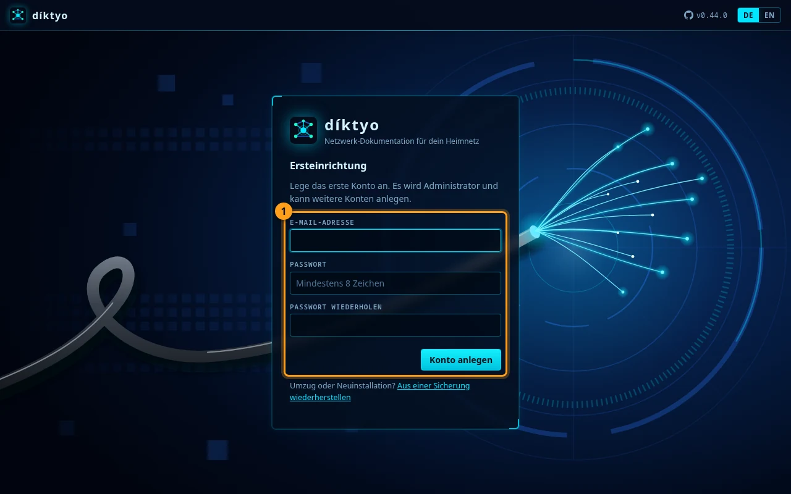
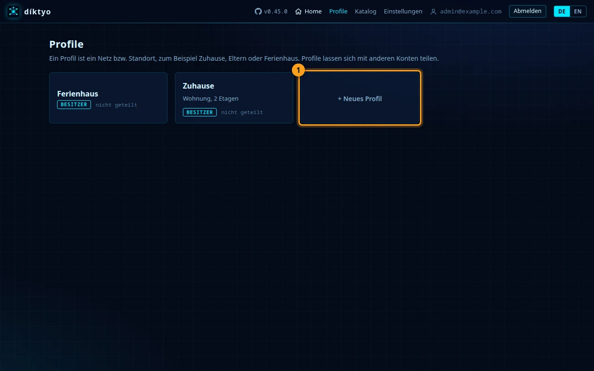
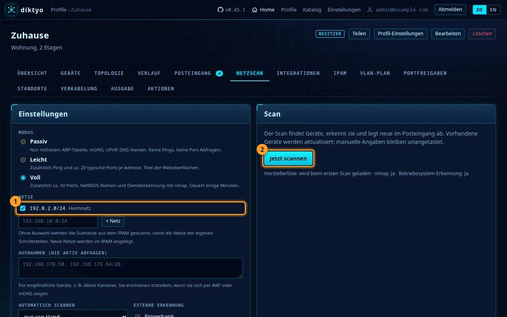
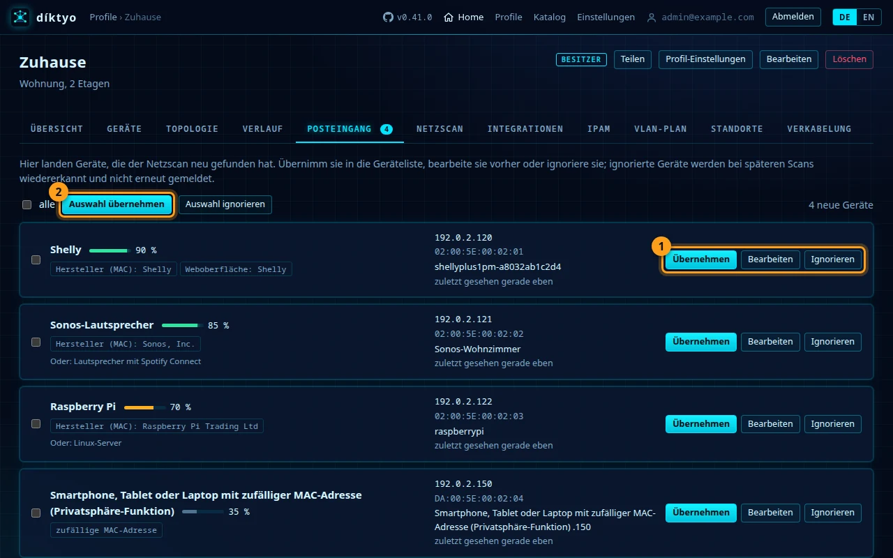
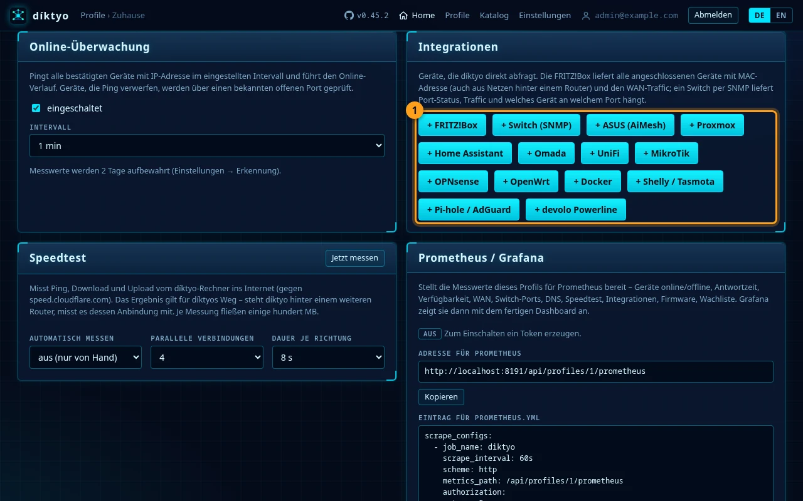
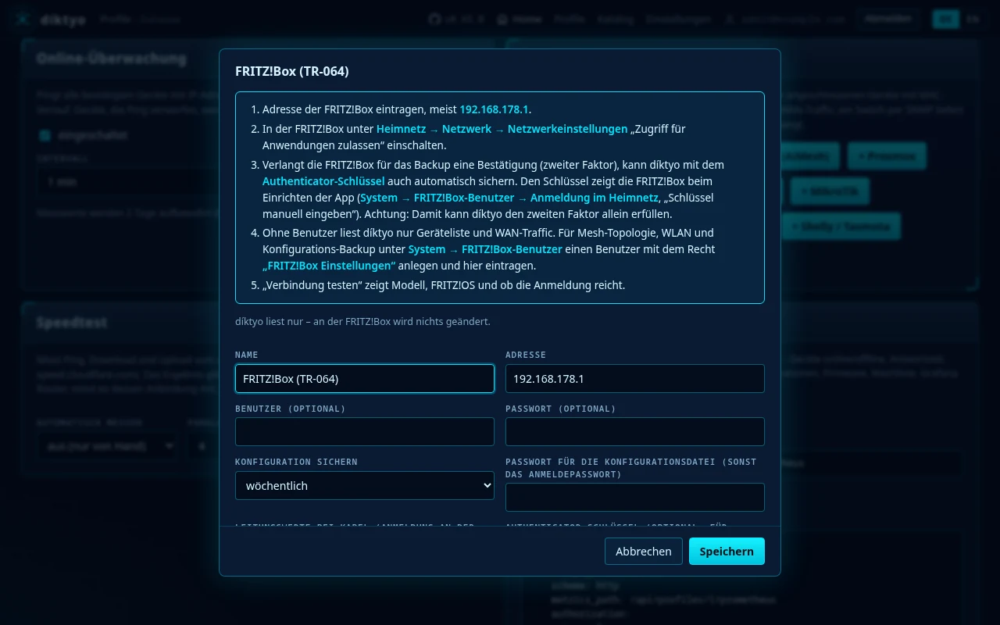
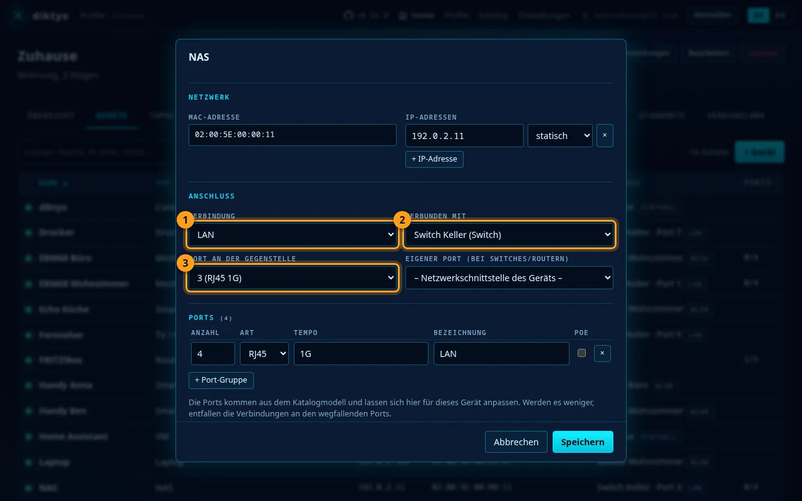
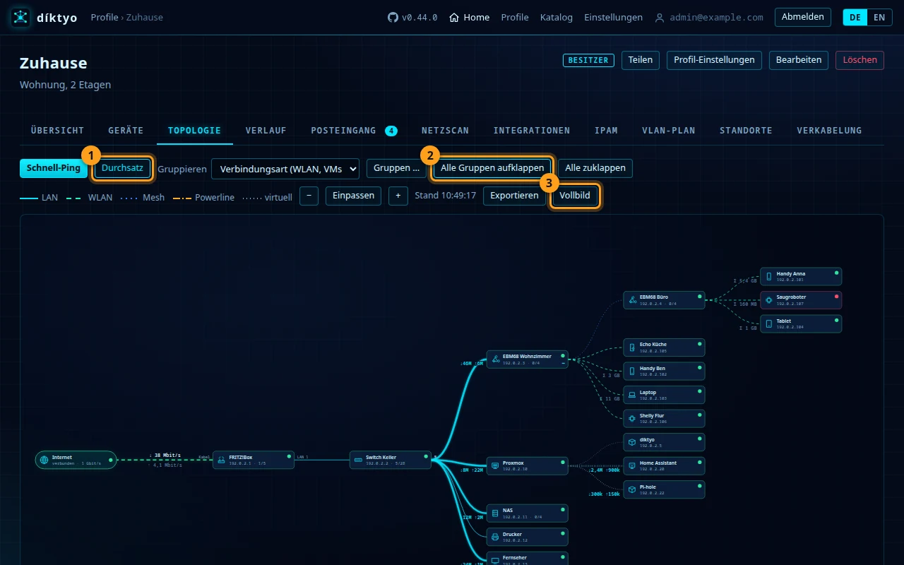
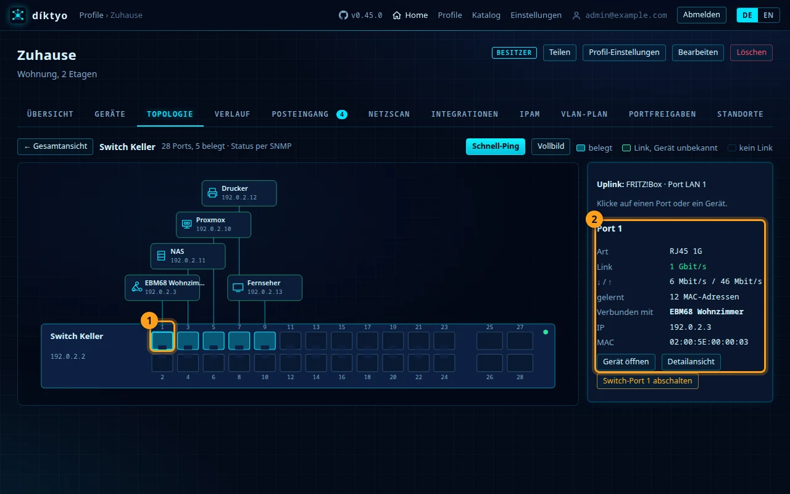
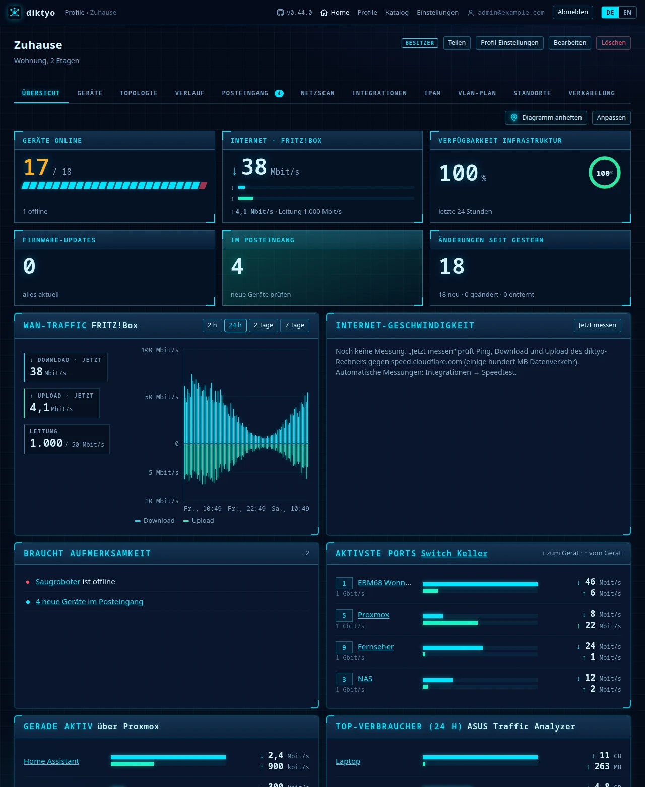

# Erste Schritte mit díktyo

In etwa 15 Minuten von der Installation zur fertigen Netzwerkkarte. Die Bilder zeigen ein Beispielnetz; die
**orangefarbenen Nummern** markieren, wo du klickst. Alles Weitere steht in der ausführlichen
[Anleitung](ANLEITUNG.de.md).

**So geht's los:**

| Schritt | Was du tust | Dauer |
|---|---|---|
| [0](#0-installieren) | díktyo installieren | 3 min |
| [1](#1-konto-anlegen) | Konto anlegen | 1 min |
| [2](#2-profil-anlegen) | Profil für dein Netz anlegen | 1 min |
| [3](#3-netz-scannen) | Netz scannen | 2 min |
| [4](#4-gefundene-geräte-übernehmen) | Gefundene Geräte übernehmen | 3 min |
| [5](#5-router-und-switch-verbinden-integrationen) | Router und Switch verbinden (Integrationen) | 3 min |
| [6](#6-verbindungen-prüfen-und-ergänzen) | Verbindungen prüfen und ergänzen | nach Bedarf |
| [7](#7-ergebnis-topologie-ports-übersicht) | Ergebnis ansehen: Topologie, Ports, Übersicht | – |

---

## 0. Installieren

Am einfachsten als Container auf einem Proxmox-Host. Diesen Befehl in der **Shell des Proxmox-Hosts** (als root)
ausführen:

```bash
bash -c "$(curl -fsSL https://raw.githubusercontent.com/xpistaki-bit/diktyo/main/install/install-proxmox.sh)"
```

Am Ende steht die Adresse, z. B. `http://192.168.178.50:8090`. Ohne Proxmox geht es mit Docker:

```bash
git clone https://github.com/xpistaki-bit/diktyo.git && cd diktyo && docker compose up -d --build
```

Dann im Browser `http://<adresse-des-rechners>:8090` öffnen. Optionen (feste IP, VLANs) stehen im
[README](../README.md#installation).

> **Tipp:** díktyo sollte im selben Netz laufen wie deine Geräte. Nur dann sieht der Scan MAC-Adressen und
> Gerätenamen.

## 1. Konto anlegen

Beim ersten Aufruf legst du das erste Konto an. Es wird Administrator.



**①** E-Mail-Adresse und Passwort eintragen, **Konto anlegen**. Über **DE/EN** oben rechts wechselst du jederzeit
die Sprache.

## 2. Profil anlegen

Ein **Profil** ist ein Netz bzw. ein Ort, zum Beispiel *Zuhause*, *Eltern* oder *Ferienhaus*. Jedes Profil hat seine
eigenen Geräte, Scans und Integrationen und lässt sich mit anderen Konten teilen.



**①** **+ Neues Profil**, Namen eingeben, **Anlegen**. Danach öffnet ein Klick auf die Kachel das Profil.

## 3. Netz scannen

Im Profil oben auf den Reiter **Netzscan**.



1. **①** Das Netz ist schon ausgewählt: díktyo kennt das Netz, in dem es läuft. Weitere Netze (z. B. ein Gäste-
   oder IoT-VLAN) fügst du mit **+ Netz** hinzu.
2. **②** **Jetzt scannen**. Modus **Voll** dauert ein paar Minuten und erkennt am meisten.

Unter *Automatisch scannen* lässt sich der Scan z. B. täglich wiederholen. Dann meldet díktyo neue Geräte von
selbst.

## 4. Gefundene Geräte übernehmen

Neu gefundene Geräte landen im **Posteingang**. Die Zahl am Reiter zeigt, wie viele warten. díktyo schlägt vor, was
es ist, und zeigt den Grund (Hersteller der MAC, Name, Weboberfläche …).



- **①** **Übernehmen**: das Gerät kommt in die Geräteliste. **Bearbeiten**: vorher Namen, Typ, Standort ändern.
  **Ignorieren**: wird bei späteren Scans nicht wieder gemeldet.
- **②** Viele auf einmal: Häkchen setzen (oder **alle**) und **Auswahl übernehmen**.

> Geräte mit **zufälliger MAC-Adresse** sind meist Handys mit eingeschalteter Privatsphäre-Funktion. Für einen
> festen Eintrag in der WLAN-Einstellung des Handys für dein Netz die „private Adresse“ ausschalten.

## 5. Router und Switch verbinden (Integrationen)

Der Scan sieht, *dass* ein Gerät da ist. **Integrationen** fragen deinen Router, Switch oder Proxmox direkt und
wissen deshalb, *wo* es hängt: an welchem Port, an welchem Access Point, auf welchem Host. Daraus entsteht die
Topologie automatisch, mit Live-Status und Datendurchsatz.

Reiter **Integrationen**:



**①** Passenden Knopf wählen, **②** danach erscheint die Integration als Karte mit Status und Traffic.

Jeder Dialog erklärt Schritt für Schritt, was am Gerät einzustellen ist:



Adresse und Zugangsdaten eintragen, **Verbindung testen**, **Speichern**. Ab dann fragt díktyo das Gerät regelmäßig
ab. **Welche Integration passt zu mir?**

| Du hast … | Nimm | Das bringt es |
|---|---|---|
| FRITZ!Box | **+ FRITZ!Box** | alle Geräte mit Namen, WAN-Traffic, Mesh, Konfig-Backup |
| Switch mit SNMP (z. B. Zyxel, TP-Link, Netgear) | **+ Switch (SNMP)** | welches Gerät an welchem Port hängt, Port-Status und -Traffic |
| ASUS-Router / AiMesh | **+ ASUS (AiMesh)** | WLAN-Clients je Mesh-Knoten, Traffic Monitor, Verbrauch je Gerät |
| Proxmox | **+ Proxmox** | VMs und Container mit IP, hängen am richtigen Host |
| MikroTik, OPNsense | **+ MikroTik** / **+ OPNsense** | Ports, Clients, WAN, Live-Raten je Gerät |
| UniFi- oder Omada-Controller | **+ UniFi** / **+ Omada** | ganze Netze mit Access Points und Switches |
| Home Assistant, Docker | **+ Home Assistant** / **+ Docker** | Namen und Bereiche bzw. Container |

Alle Integrationen **lesen nur**. Schalten (z. B. einen Port abschalten) ist eine eigene, abgesicherte Funktion,
siehe [Anleitung](ANLEITUNG.de.md).

## 6. Verbindungen prüfen und ergänzen

Was keine Integration weiß (z. B. ein Gerät an einem einfachen Switch ohne SNMP), trägst du von Hand ein. Reiter
**Geräte**, Gerät anklicken, Abschnitt **Anschluss**:



1. **①** **Verbindung**: LAN, WLAN, Mesh oder virtuell (VM/Container).
2. **②** **Verbunden mit**: das Gerät, an dem es hängt (Switch, Access Point, Host).
3. **③** **Port an der Gegenstelle**: der Port am Switch bzw. Router. So entsteht die Portbelegung.

**Speichern**. Die Topologie ist sofort aktuell.

## 7. Ergebnis: Topologie, Ports, Übersicht

**Topologie**: das ganze Netz vom Internet bis zum letzten Gerät.



- **①** **Durchsatz** zeigt an jeder Linie den aktuellen Datenverkehr: kabelgebunden vom Switch, VMs von Proxmox, WLAN
  je nach Router live oder als Tagesmenge (Σ).
- **②** Viele WLAN-Geräte oder VMs werden zu einer Gruppe zusammengefasst. **Alle Gruppen aufklappen** zeigt sie
  einzeln.
- **③** **Vollbild** für große Netze. Geräte lassen sich mit der Maus verschieben, díktyo merkt sich die Position.
- **Doppelklick** auf einen Switch oder Router öffnet die Port-Ansicht:



**①** Port anklicken, **②** rechts stehen Link, Tempo, Traffic, angeschlossenes Gerät und, wenn freigeschaltet, die
Aktionen (Port abschalten, PoE neu starten).

**Übersicht**: der erste Reiter im Profil. Was gerade los ist und was Aufmerksamkeit braucht.



Oben die Kennzahlen, darunter offline gegangene Geräte, neue Geräte im Posteingang, Firmware-Updates, Internet-
Verkehr, Antwortzeiten, die aktivsten Ports, die größten Verbraucher und wer gerade Daten schiebt. Die Seite
aktualisiert sich alle 30 Sekunden von selbst.

---

## Wie geht's weiter?

| Wenn du … | Dann |
|---|---|
| eine Netzwerkkarte zum Ausdrucken willst | Reiter **Ausgabe**: PDF mit Topologie, Geräteliste, IP-Plan |
| sehen willst, was sich geändert hat | Reiter **Verlauf**: wer, was, wann, mit Vorher/Nachher |
| Subnetze, VLANs, feste IPs planst | Reiter **IPAM** |
| wissen willst, wo ein Gerät steht | Reiter **Standorte** (Keller, Büro, Rack …) |
| das Netz mit jemandem teilen willst | Reiter **Freigabe** |
| Konfigurationen sichern willst | Integration bearbeiten, *Konfiguration sichern* (FRITZ!Box, ASUS, MikroTik, OPNsense, Switch per SSH) |
| díktyo selbst sichern willst | **Einstellungen**, *Backup*: ZIP mit allem, auch automatisch auf NAS oder Cloud |

Etwas klappt nicht? Abschnitt [„Wenn etwas nicht klappt“](ANLEITUNG.de.md#10-wenn-etwas-nicht-klappt) der Anleitung.
Bei Switch (SNMP) und ASUS zeigt der Knopf **Diagnose** an der Integration Schritt für Schritt, was das Gerät liefert.
