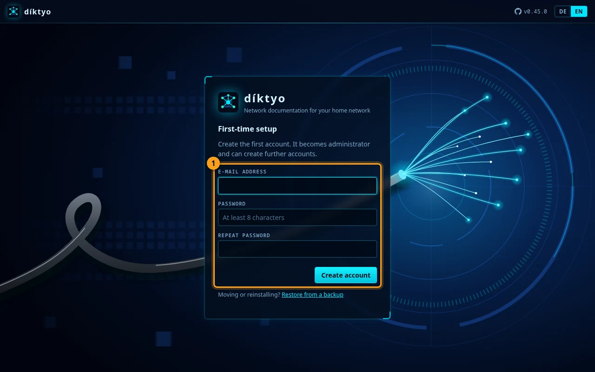
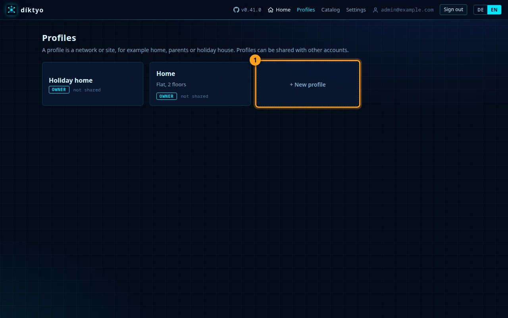
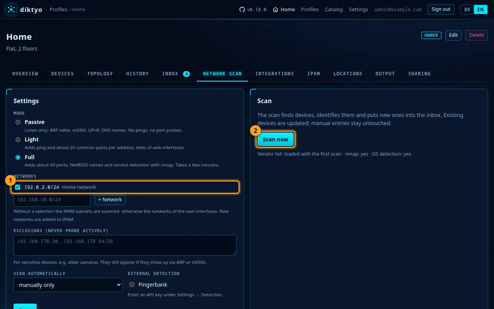
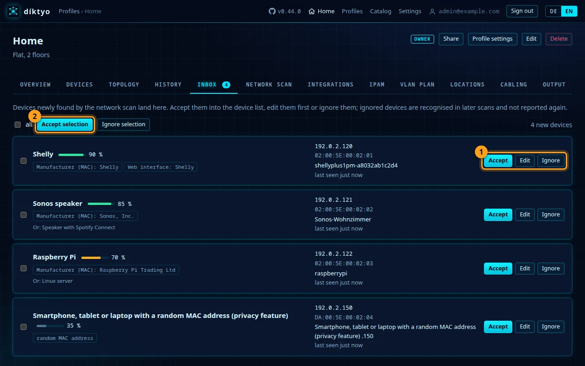
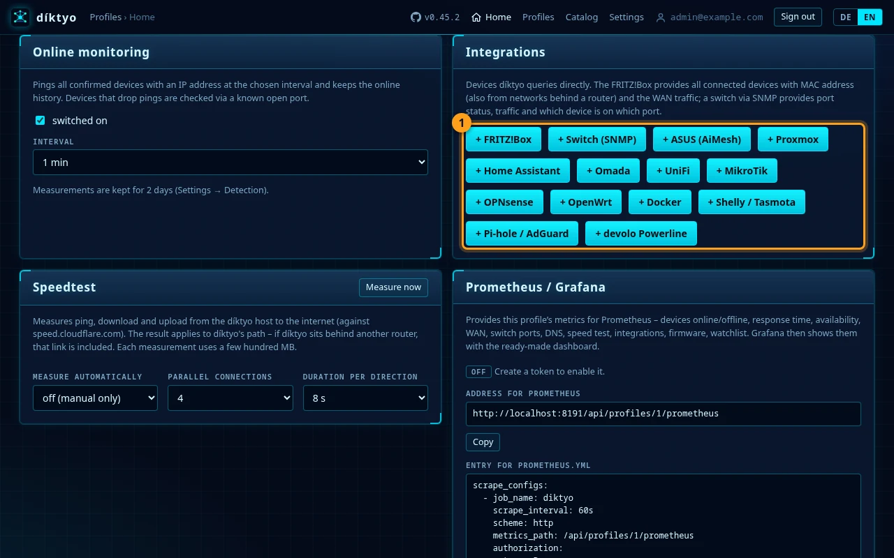
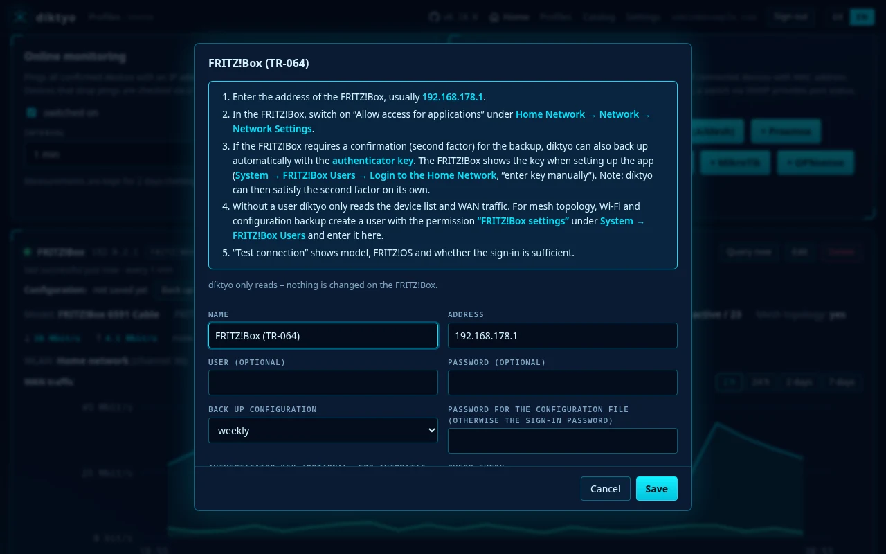
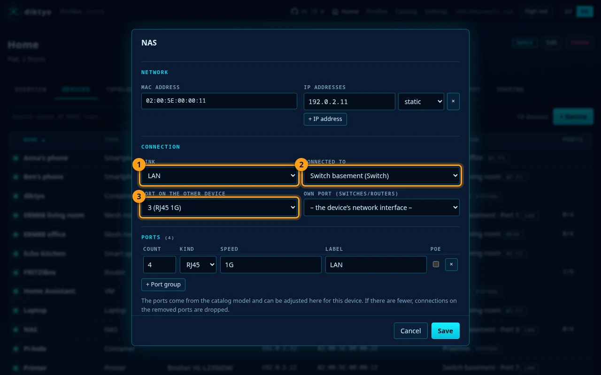
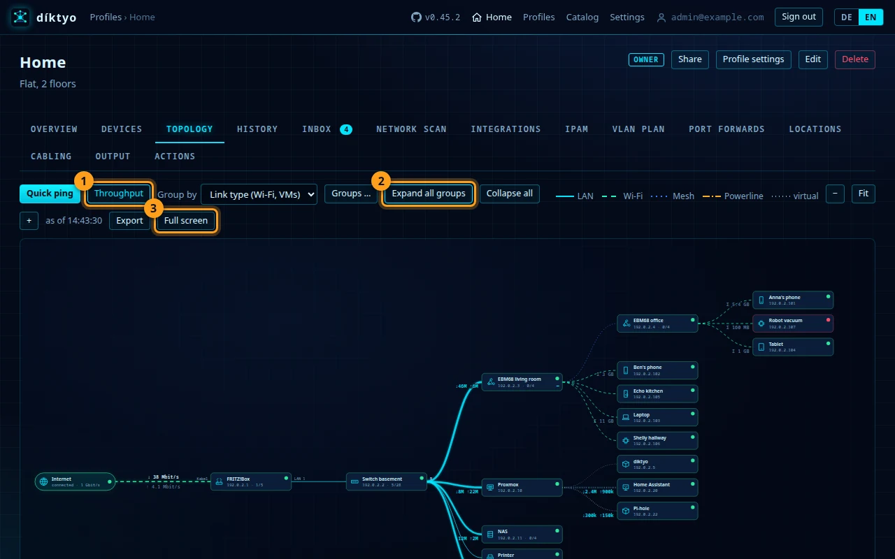
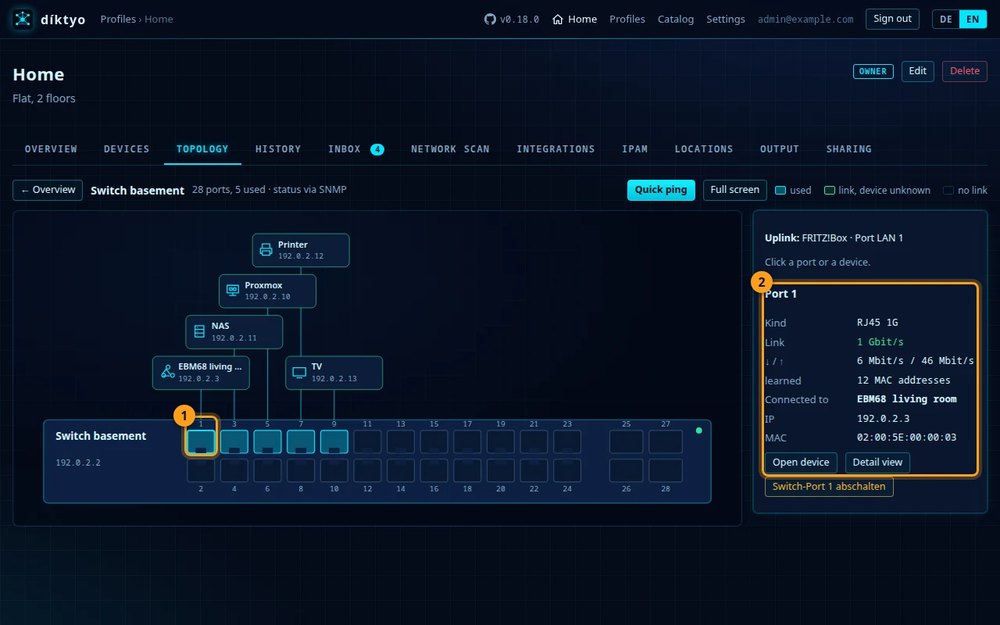
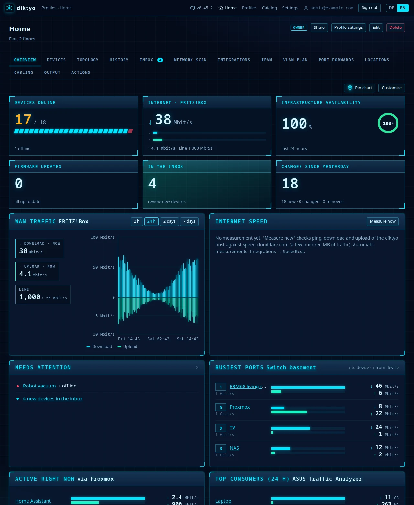

# Getting started with díktyo

From installation to a finished network map in about 15 minutes. The pictures show an example network; the
**orange numbers** mark where to click. Everything else is in the [README](../README.md) (German step-by-step guide:
[ANLEITUNG.de.md](ANLEITUNG.de.md), short German version of this page: [ERSTE-SCHRITTE.de.md](ERSTE-SCHRITTE.de.md)).

| Step | What you do | Time |
|---|---|---|
| [0](#0-install) | Install díktyo | 3 min |
| [1](#1-create-your-account) | Create your account | 1 min |
| [2](#2-create-a-profile) | Create a profile for your network | 1 min |
| [3](#3-scan-the-network) | Scan the network | 2 min |
| [4](#4-accept-the-devices-found) | Accept the devices found | 3 min |
| [5](#5-connect-router-and-switch-integrations) | Connect router and switch (integrations) | 3 min |
| [6](#6-check-and-complete-connections) | Check and complete connections | as needed |
| [7](#7-the-result-topology-ports-overview) | Look at the result: topology, ports, overview | – |

---

## 0. Install

Easiest as a container on a Proxmox host. Run this in the **shell of the Proxmox host** (as root):

```bash
bash -c "$(curl -fsSL https://raw.githubusercontent.com/xpistaki-bit/diktyo/main/install/install-proxmox.sh)"
```

It prints the address at the end, for example `http://192.168.178.50:8090`. Without Proxmox, use Docker:

```bash
git clone https://github.com/xpistaki-bit/diktyo.git && cd diktyo && docker compose up -d --build
```

Then open `http://<address-of-the-machine>:8090` in the browser. Options (static IP, VLANs) are in the
[README](../README.md#installation).

> **Tip:** run díktyo in the same network as your devices. Only then does the scan see MAC addresses and device
> names.

## 1. Create your account

On the first visit you create the first account. It becomes administrator.



**①** Enter e-mail address and password, **Create account**. **DE/EN** at the top right switches the language at any
time.

## 2. Create a profile

A **profile** is one network or place, for example *Home*, *Parents* or *Holiday home*. Each profile has its own
devices, scans and integrations and can be shared with other accounts.



**①** **+ New profile**, enter a name, **Create**. Click the tile to open the profile.

## 3. Scan the network

In the profile, open the **Network scan** tab.



1. **①** The network is already selected: díktyo knows the network it runs in. Add more (for example a guest or IoT
   VLAN) with **+ Network**.
2. **②** **Scan now**. Mode **Full** takes a few minutes and recognises the most.

*Scan automatically* repeats the scan, for example daily; díktyo then reports new devices by itself.

## 4. Accept the devices found

Newly found devices land in the **Inbox**; the number on the tab shows how many are waiting. díktyo suggests what each
device is and shows why (MAC vendor, name, web interface …).



- **①** **Accept** moves the device into the device list. **Edit** lets you change name, type or location first.
  **Ignore** stops it from being reported again.
- **②** Many at once: tick them (or **all**) and **Accept selection**.

> Devices with a **random MAC address** are usually phones with the privacy feature on. For a stable entry, turn off
> the "private address" for your network in the phone's Wi-Fi settings.

## 5. Connect router and switch (integrations)

The scan sees *that* a device is there. **Integrations** ask your router, switch or Proxmox directly and therefore know
*where* it is connected: which port, which access point, which host. The topology then builds itself, with live
status and throughput.

**Integrations** tab:



**①** Pick the matching button; **②** the integration then appears as a card with status and traffic.

Every dialog explains step by step what to set on the device:



Enter address and credentials, **Test connection**, **Save**. From then on díktyo polls the device regularly.
**Which integration fits?**

| You have … | Use | What you get |
|---|---|---|
| FRITZ!Box | **+ FRITZ!Box** | all devices with names, WAN traffic, mesh, config backup |
| Switch with SNMP (e.g. Zyxel, TP-Link, Netgear) | **+ Switch (SNMP)** | which device is on which port, port status and traffic |
| ASUS router / AiMesh | **+ ASUS (AiMesh)** | Wi-Fi clients per mesh node, traffic monitor, volume per device |
| Proxmox | **+ Proxmox** | VMs and containers with IP, attached to the right host |
| MikroTik, OPNsense | **+ MikroTik** / **+ OPNsense** | ports, clients, WAN, live rates per device |
| UniFi or Omada controller | **+ UniFi** / **+ Omada** | whole networks with access points and switches |
| Home Assistant, Docker | **+ Home Assistant** / **+ Docker** | names and areas, or containers |

All integrations **only read**. Switching (for example turning a port off) is a separate, safeguarded feature; see
[Actions](../README.md#actions).

## 6. Check and complete connections

Whatever no integration knows (for example a device behind a simple switch without SNMP) you enter by hand. **Devices**
tab, click the device, section **Connection**:



1. **①** **Link**: LAN, Wi-Fi, mesh or virtual (VM/container).
2. **②** **Connected to**: the device it hangs off (switch, access point, host).
3. **③** **Port on the other device**: the port on the switch or router; this fills the port map.

**Save**; the topology updates immediately.

## 7. The result: topology, ports, overview

**Topology**: the whole network from the internet to the last device.



- **①** **Throughput** shows the current traffic on every line: wired from the switch, VMs from Proxmox, Wi-Fi live or
  as daily volume (Σ) depending on the router.
- **②** Many Wi-Fi devices or VMs are grouped; **Expand all groups** shows them one by one.
- **③** **Full screen** for large networks. Drag devices with the mouse; díktyo remembers their position.
- **Double-click** a switch or router to open the port view:



**①** Click a port; **②** on the right: link, speed, traffic, connected device and, if enabled, actions (turn port
off, restart PoE).

**Overview**: the first tab of a profile. What is going on and what needs attention.



Key figures at the top; below them devices that went offline, new devices in the inbox, firmware updates, internet
traffic, response times, the busiest ports, the top consumers and who is moving data right now. The page refreshes
itself every 30 seconds.

---

## Where to go next

| If you want to … | Then |
|---|---|
| print a network map | **Output** tab: PDF with topology, device list, IP plan |
| see what changed | **History** tab: who, what, when, with before/after |
| plan subnets, VLANs, static IPs | **IPAM** tab |
| record where a device is | **Locations** tab (basement, office, rack …) |
| share the network with someone | **Sharing** tab |
| back up device configurations | edit the integration, *Back up configuration* (FRITZ!Box, ASUS, MikroTik, OPNsense, switch via SSH) |
| back up díktyo itself | **Settings**, *Backup*: ZIP with everything, also automatically to a NAS or the cloud |

Something not working? For switch (SNMP) and ASUS integrations, the **Diagnose** button on the integration shows step
by step what the device returns.
